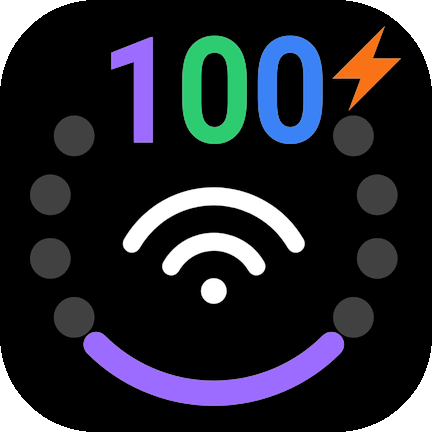

# OmniBar

<strong>状态栏多合一 · ColorOS 17</strong>

OmniBar 是需要 Root + LSPosed（或兼容 legacy Xposed 框架）的 Android 模块，在 ColorOS 17 状态栏原有的电量宿主内，绘制一个把**电量、Wi-Fi、蜂窝信号**揉在一起的状态指示器：外圈电量弧 + 中心 Wi-Fi/网络类型 + 底部信号点，一眼看清设备状态。

> 致谢「多合一状态指示器」这一创意。

## 特性
仅在一加15，c17测试通过

### 状态栏指示器

- **外圈约 240° 电弧表示电量**，保留暗色底轨；未知电量不编造进度。
- **中心 Wi-Fi** 用三道弧线 + 一个点，共四层信号等级；连接中的动画、无互联网/需登录的「!」「?」大字标注、未连接时的网络类型（2G/3G/4G/5G）或 `SOS`/`sim`/占位横条都集中在同一块区域。
- **底部四点表示默认数据卡信号**；开启「双卡信号环」后，改为电池环底部的两段同心弧段分别表示主卡（外圈）与副卡（内圈）。
- **漫游**用「R」标记 + 对应信号点/环段改用漫游色（默认蓝）区分。
- **WiFi 代数显示**：连接 Wi-Fi 时在图标右下角标出当前代际 5/6/7/8，一眼判断连的是 WiFi 5 还是 WiFi 7。
- 支持锁屏与状态栏同时显示；继承 SystemUI 父级防烧屏移动。

### 状态配色

- **电池状态色**
- 按优先级着色：充电/充满 → 严重低电量（默认 ≤10%）→ 低电量（默认 ≤20%）→ 省电模式 → 正常；数字和中心信号不强制变色。

-  **充电协议配色**
-  SuperVOOC 或原装百瓦 UFCS 档位 → 紫🟣；
-  第三方 UFCS → 绿🟢；
-  PD / DCP / PPS → 蓝🔵；
-  普通 / 慢充 → 橙🟠。
-  第三方充电器绝不因功率高而显示紫色。
-  也可自定义颜色。

### 更多标记

- **VPN** 连接时在电池环右上角显示盾形标记（可关闭）。
- **充电闪电 / 充满对勾**位于电量弧顶部，周围局部渐变虚化，优先于所有数字模式。
- 电量数字支持「始终显示」或「低于阈值自动显示」，互斥切换，可全部关闭。

## 安装与恢复

1. 必须已root
2. LSPosed 只勾选 `com.android.systemui`。
3. 勾选作用域后重启手机。
4. 删除模块重启手机，恢复原厂。

详细说明：

- [安装、更新与恢复](docs/INSTALL.md)
- [功能与设置参数](docs/SETTINGS.md)
- [构建说明](docs/BUILD.md)
- [功能边界与验收状态](docs/COMPATIBILITY.md)
- [更新日志](CHANGELOG.md)
- [贡献指南](CONTRIBUTING.md)
- [安全说明](SECURITY.md)

## 许可证

暂未指定。
